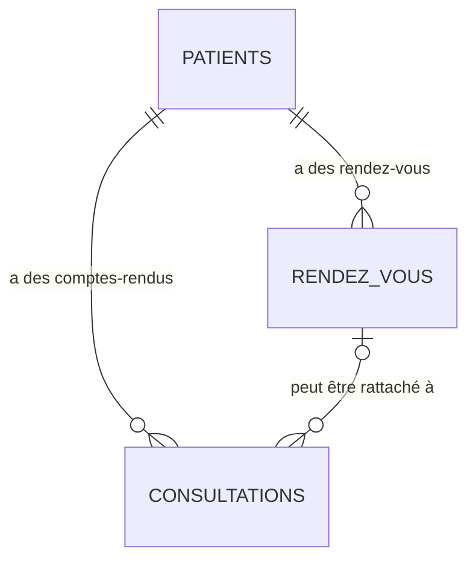
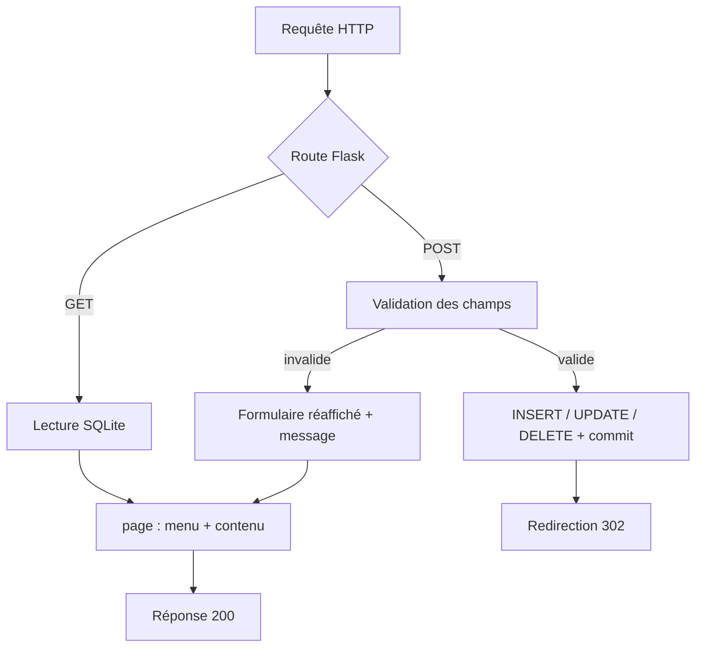

# Spécification — Gestion de cabinet de neurologie

| | |
|---|---|
| Version | 1.0 |
| Date | 2026-10-24 |
| Portée | Application web locale de gestion des patients, rendez-vous et comptes-rendus de consultation |

## 1. Contexte et objectif

Application Flask mono-utilisateur permettant de :

- gérer le fichier patients (création, consultation, modification) ;
- planifier, modifier et supprimer des rendez-vous ;
- rédiger, consulter, filtrer et modifier des comptes-rendus de consultation ;
- naviguer d'un patient vers ses rendez-vous et ses comptes-rendus.

L'application est destinée à un usage local (poste unique, réseau de confiance). Elle ne comporte ni authentification, ni gestion de rôles, ni API JSON : toutes les pages sont rendues côté serveur.

## 2. Stack technique

| Élément | Valeur |
|---|---|
| Langage | Python 3.14 |
| Framework web | Flask 3.1.3 |
| Base de données | SQLite (module standard `sqlite3`) |
| Rendu | HTML généré dans `app.py`, CSS inline, aucun template externe |
| JavaScript | uniquement la confirmation `confirm()` avant suppression d'un RDV |
| URL locale | `http://127.0.0.1:5000/` |

## 3. Cartographie fonctionnelle

### 3.1 Routes

| Méthode | URL | Fonction | Comportement |
|---|---|---|---|
| GET | `/` | `accueil` | Redirige vers `/patients` |
| GET | `/patients` | `liste_patients` | Liste des patients (nom, prénom, date de naissance), chaque nom mène à la fiche |
| GET, POST | `/patients/nouveau` | `nouveau_patient` | Formulaire de création ; succès → `/patients/<id>` |
| GET | `/patients/<id>` | `fiche_patient` | Identité, rendez-vous et comptes-rendus du patient ; 404 si inconnu |
| GET, POST | `/patients/<id>/modifier` | `modifier_patient` | Formulaire pré-rempli ; succès → `/patients/<id>` ; 404 si inconnu |
| GET | `/rendez-vous` | `liste_rendez_vous` | Tous les RDV (date, heure, patient, motif, statut) avec boutons Modifier / Supprimer |
| GET, POST | `/rendez-vous/nouveau` | `nouveau_rendez_vous` | Formulaire de prise de RDV ; `?patient_id=` présélectionne le patient ; succès → `/patients/<patient>` |
| GET, POST | `/rendez-vous/<id>/modifier` | `modifier_rendez_vous` | Formulaire pré-rempli, statut modifiable ; succès → `/rendez-vous` ; 404 si inconnu |
| POST | `/rendez-vous/<id>/supprimer` | `supprimer_rendez_vous` | Supprime le RDV ; GET → 405 ; 404 si inconnu ; succès → `/rendez-vous` |
| GET | `/consultations` | `liste_consultations` | Tableau à 3 colonnes (patient, médecin, date), filtre `?medecin=` |
| GET | `/consultations/nouveau` | `nouveau_compte_rendu` | Formulaire de saisie ; `?patient_id=` et `?rendez_vous_id=` présélectionnent ; succès → `/consultations` |
| GET | `/consultations/<id>` | `detail_consultation` | Compte-rendu complet et bouton Modifier ; 404 si inconnu |
| GET, POST | `/consultations/<id>/modifier` | `modifier_compte_rendu` | Formulaire pré-rempli ; succès → `/consultations/<id>` ; 404 si inconnu |

### 3.2 Navigation et présentation

- Menu permanent en haut de page : **Patients**, **Rendez-vous**, **Consultations**. L'entrée courante est mise en évidence (classe `actif`).
- Le menu et les boutons d'action partagent la forme « bouton » ; le menu est gris (`#555`), les actions sont bleues (`#0066cc`), les suppressions rouges (`.danger`).
- Toutes les pages partagent le même squelette HTML (`<!DOCTYPE html>`, `<head>` avec CSS inline, `<nav>`, `<main>`, `<h1>`) fourni par `page()`.

### 3.3 Domaine « Patients »

**Liste** : une entrée par patient, ordonnée par nom ; nom et prénom cliquables ; bouton « Ajouter un patient ».

**Fiche** :
- identité : date de naissance, téléphone, email ;
- actions : prendre un rendez-vous, modifier le patient, rédiger un compte-rendu ;
- section « Rendez-vous » : date, heure, motif, statut + boutons Modifier / Supprimer ;
- section « Comptes-rendus de consultation » : date, médecin, motif + boutons Voir / Modifier ;
- messages dédiés si une section est vide.

**Création / modification** : formulaire commun ; les champs facultatifs laissés vides sont enregistrés à `NULL`.

### 3.4 Domaine « Rendez-vous »

- Liste globale triée par date puis heure.
- Création : patient obligatoire, date et heure obligatoires, motif facultatif ; statut forcé à `prévu`.
- Modification : patient, date, heure, motif et statut (`prévu`, `honoré`, `annulé`).
- Suppression : uniquement en `POST`, avec confirmation navigateur. Les comptes-rendus liés sont conservés : leur `rendez_vous_id` est mis à `NULL`.

### 3.5 Domaine « Consultations »

- Liste compacte : patient (lien vers le compte-rendu), médecin, date. Le contenu n'apparaît que sur la page de détail.
- Filtre par médecin (liste des valeurs distinctes non vides) ; valeur exacte ; un médecin sans résultat reste sélectionnable et affiche « Aucun compte-rendu pour ce médecin. ».
- Saisie : patient obligatoire, date obligatoire (pré-remplie au jour courant), rendez-vous facultatif, motif / observations / diagnostic / traitement / médecin facultatifs.
- Détail : patient cliquable, médecin, date, rendez-vous lié éventuel, puis motif, observations, diagnostic, traitement ; `—` pour un champ vide ; bouton « Modifier ce compte-rendu ».
- Modification : même formulaire que la saisie, pré-rempli.

## 4. Règles de validation

| Formulaire | Champ | Règle | Message en cas d'échec |
|---|---|---|---|
| Patient | `nom`, `prenom` | non vides après `strip()` | « Le nom et le prénom sont obligatoires. » |
| Patient | `date_naissance` | vide, ou date `AAAA-MM-JJ` valide | « La date de naissance n'est pas valide. » |
| Patient | `sexe` | `""`, `F`, `M` ou `Autre` | « La valeur choisie pour le sexe n'est pas valide. » |
| RDV | `patient_id` | entier désignant un patient existant | « Merci de choisir un patient. » |
| RDV | `date_rdv`, `heure_rdv` | date `AAAA-MM-JJ` et heure `HH:MM` valides | « Merci de saisir une date et une heure valides. » |
| RDV (édition) | `statut` | `prévu`, `honoré` ou `annulé` | « Le statut choisi n'est pas valide. » |
| Consultation | `patient_id` | entier désignant un patient existant | « Merci de choisir un patient. » |
| Consultation | `rendez_vous_id` | vide, ou RDV existant appartenant au patient choisi | « Le rendez-vous choisi n'existe pas. » / « Le rendez-vous choisi n'appartient pas à ce patient. » |
| Consultation | `date_consultation` | date `AAAA-MM-JJ` valide | « Merci de saisir une date valide. » |

En cas d'erreur : réponse `200`, formulaire réaffiché avec les valeurs déjà saisies, aucune écriture en base. Les champs facultatifs vides deviennent `NULL`.

## 5. Modèle de données

### 5.1 Relations



- Un patient possède zéro ou plusieurs rendez-vous et zéro ou plusieurs comptes-rendus.
- Un compte-rendu référence au plus un rendez-vous ; un rendez-vous peut être référencé par plusieurs comptes-rendus (aucune contrainte d'unicité).

### 5.2 Schéma SQL

```sql
CREATE TABLE patients (
    id INTEGER PRIMARY KEY AUTOINCREMENT,
    nom TEXT NOT NULL,
    prenom TEXT NOT NULL,
    date_naissance DATE,
    sexe TEXT,
    telephone TEXT,
    email TEXT,
    adresse TEXT,
    antecedents TEXT,
    date_creation TIMESTAMP DEFAULT CURRENT_TIMESTAMP
);

CREATE TABLE rendez_vous (
    id INTEGER PRIMARY KEY AUTOINCREMENT,
    patient_id INTEGER NOT NULL,
    date_rdv DATE NOT NULL,
    heure_rdv TIME NOT NULL,
    motif TEXT,
    statut TEXT DEFAULT 'prévu',
    FOREIGN KEY (patient_id) REFERENCES patients (id)
);

CREATE TABLE consultations (
    id INTEGER PRIMARY KEY AUTOINCREMENT,
    patient_id INTEGER NOT NULL,
    rendez_vous_id INTEGER,
    date_consultation DATE NOT NULL,
    motif TEXT,
    observations TEXT,
    diagnostic TEXT,
    traitement TEXT,
    medecin TEXT,
    FOREIGN KEY (patient_id) REFERENCES patients (id),
    FOREIGN KEY (rendez_vous_id) REFERENCES rendez_vous (id)
);
```

### 5.3 Règles d'intégrité

- SQLite est utilisé sans `PRAGMA foreign_keys = ON` : les clés étrangères sont déclaratives. L'intégrité est garantie par l'application (existence du patient, appartenance du RDV au patient).
- Dates et heures sont stockées en texte (`AAAA-MM-JJ`, `HH:MM`) ; `date_creation` est renseignée automatiquement.
- Suppression d'un RDV : `consultations.rendez_vous_id` des comptes-rendus liés passe à `NULL`, les comptes-rendus sont conservés.
- Il n'existe aucune suppression de patient ni de compte-rendu.

## 6. Organisation de l'application

### 6.1 Arborescence

```text
cabinet-neurologie/
├── app.py                  # application Flask complète
├── requirements.txt        # dépendances (Flask 3.1.3, Jinja2, Werkzeug, …)
├── README.md
├── SPECIFICATION.md        # ce document
├── LICENSE
└── database/
    ├── cabinet.db          # base SQLite
    ├── create_db.py        # création du schéma
    ├── peupler_donnees.py  # jeu de données fictif
    └── Description.md      # contexte de création de la base
```

Le venv local et les fichiers de clés ne font pas partie de l'application et ne sont pas utilisés par celle-ci.

### 6.2 Structure de `app.py`

| Unité | Rôle |
|---|---|
| `PAGES` | Menu : adresse + libellé |
| `se_connecter_a_la_base()` | Ouvre `database/cabinet.db` avec `row_factory = sqlite3.Row` |
| `menu()` | Construit le `<nav>` et marque la page courante |
| `page(titre, contenu)` | Squelette HTML commun, CSS inline, échappement du titre |
| `CHAMPS_PATIENT`, `SEXES` | Constantes du formulaire patient |
| `CHAMPS_RDV`, `STATUTS_RDV` | Constantes du formulaire RDV |
| `CHAMPS_CONSULTATION` | Constantes du formulaire de compte-rendu |
| `valeurs_depuis_formulaire_patient()`, `erreur_formulaire_patient()`, `formulaire_patient()` | Lecture, validation et rendu du formulaire patient |
| `patients_et_rendez_vous()`, `valider_consultation()`, `formulaire_consultation()` | Listes, validation et rendu des comptes-rendus |
| `valider_rendez_vous()`, `formulaire_rendez_vous()`, `boutons_rdv()` | Validation, rendu et actions des RDV |
| Routes | Lecture SQLite, validation, écriture avec `commit()`, redirections |

Chaque requête ouvre une connexion SQLite, exécute des requêtes **paramétrées**, appelle `commit()` après écriture et ferme la connexion. Aucun état global n'est conservé entre requêtes.

### 6.3 Cycle d'une requête



### 6.4 Rendu HTML

- Tout le HTML est construit par concaténation de chaînes dans les fonctions de route et les helpers de formulaire.
- Les chaînes issues de la saisie (patients, RDV, comptes-rendus, valeur du filtre, titres de page) sont échappées avec `markupsafe.escape` avant affichage. Les dates, heures et statuts, dont le format est contraint à l'écriture, sont affichés tels quels.
- Les boutons d'action sont des liens `<a class="bouton">` ; les soumissions utilisent `<button>` ; la suppression utilise un formulaire `POST` avec `confirm()`.

## 7. Limites connues

- Aucune authentification, aucun contrôle d'accès, aucun jeton CSRF : usage local uniquement.
- `app.run(debug=True)` : mode développement à ne pas exposer.
- Pas de pagination, de recherche patient, ni de tri configurable.
- Pas de contrôle de chevauchement des rendez-vous.
- Email et téléphone non validés côté serveur (seuls les `type="email"` / `type="tel"` HTML guident la saisie).
- Suppression limitée aux rendez-vous ; patients et comptes-rendus ne sont pas supprimables via l'interface.
- Le filtre des consultations porte sur une égalité stricte de la chaîne `medecin`.
- Aucune suite de tests automatisée versionnée.

## 8. Exploitation

Depuis la racine du projet (le chemin `database/cabinet.db` est relatif) :

```bash
python3 -m venv venv
source venv/bin/activate
pip install -r requirements.txt
python3 database/create_db.py          # uniquement si la base n'existe pas
python3 database/peupler_donnees.py    # jeu de données fictif, optionnel
python3 app.py                         # http://127.0.0.1:5000/
```

## 9. Vérification

Le comportement décrit a été vérifié avec le client de test Flask sur une copie de la base : toutes les routes (200/302 attendus), les branches de validation (aucune écriture en cas d'erreur), les redirections après écriture, l'échappement des saisies, la suppression d'un RDV lié à un compte-rendu et la cohérence des listes avec la base.
